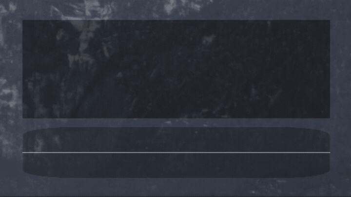

<div align="center">


# Sonori

**Local AI speech transcription with a transparent overlay for Linux**

Real-time or on-demand transcription, entirely on your device.

[](LICENSE)
[](#system-requirements)
[](#compositor-wayland)

<br>



</div>

---

> **Note:** Active development. You may encounter bugs or instability as new features are added.

## Features

### Core
- **Local AI Processing** - All transcription happens on your device, no cloud services required
- **Multi-Backend Support** - Choose between CTranslate2, Whisper.cpp, Moonshine, Parakeet TDT, or Nemotron 3.5 ASR (streaming) backends
- **Shared STT Runtime** - Speech capture, VAD, model downloads, and backend inference are provided by the reusable [`speechcore`](https://crates.io/crates/speechcore) crate ([source](https://github.com/0xPD33/speechcore)), maintained as a separate dependency and pulled in automatically when building
- **Dual Transcription Modes** - Real-time continuous transcription or manual on-demand sessions
- **Voice Activity Detection** - Uses Silero VAD for accurate speech detection
- **Automatic Model Download** - Models are downloaded automatically on first run

### Interface
- **Transparent Overlay** - Non-intrusive overlay at the bottom of your screen
- **CLI Mode** - Run without GUI using `--cli` flag for headless/terminal usage
- **Audio Visualization** - Spectrogram display shows audio input in real-time
- **System Tray Integration** - Quick access with window control and status display
- **Typewriter Effect** - Character-by-character text reveal animation when transcription completes

### Optional Features
- **GPU Acceleration** - Vulkan-based rendering; Whisper.cpp Vulkan acceleration; ONNX Runtime GPU acceleration for Moonshine, Parakeet TDT, and Nemotron 3.5 ASR backends
- **Global Shortcuts** - System-wide hotkeys via XDG Desktop Portal (e.g., Super+\ to toggle recording)
- **Auto-Paste** - Automatic text injection via XDG Desktop Portal, with wtype/dotool fallback for compositors without portal support
- **Sound Feedback** - Audio cues for recording state changes
- **Magic Mode** - Post-process transcriptions through a local LLM to clean up grammar, remove filler words, and improve readability

### Roadmap

**Planned:**
- Better error handling and UI improvements
- CUDA support for GPU acceleration
- Additional local AI backends
- Optional cloud API support (Deepgram, OpenAI)

**Not Planned:**
- GUI framework (custom wgpu/wgsl implementation by design)
- Windows/macOS support (contributions welcome)

## System Requirements

**Platform:** Linux x86_64 only

**Tested on:** NixOS with KDE Plasma/KWin and niri (Wayland)

### Compositor (Wayland)

| Protocol | Required | Purpose |
|----------|----------|---------|
| `zwlr_layer_shell_v1` | **Yes** | Transparent overlay rendering |
| XDG Portal: GlobalShortcuts | No | System-wide hotkeys |
| XDG Portal: RemoteDesktop | No | Auto-paste via portal (fallback: wtype/dotool) |

**Compositor Compatibility:**
| Compositor | Status |
|------------|--------|
| KDE Plasma (KWin) | ✅ Full support |
| niri | ✅ Full support (use IPC for keybindings) |
| Hyprland | ✅ Should work |
| Sway | ✅ Should work |
| GNOME (Mutter) | ❌ No layer shell (use CLI mode) |

### Hardware
- **GPU:** Vulkan-capable with appropriate drivers
- **Audio:** Working microphone, PipeWire or PulseAudio

## Installation

Prebuilt files are on the [Releases page](https://github.com/0xPD33/sonori/releases/latest). Before each release, CI starts both of them on Ubuntu 24.04, Debian stable, Fedora, and Arch.

They bring ONNX Runtime, PortAudio, OpenSSL 3, and JACK with them. Your system must supply:
- a Vulkan driver for your GPU and the Vulkan loader (`libvulkan1`, `vulkan-loader`, or `vulkan-icd-loader`)
- ALSA (`libasound2t64`, `alsa-lib`), which every desktop install has
- `wl-clipboard`, and `wtype` or `dotool`, for copy and auto-paste

### AppImage (Recommended)

```bash
chmod +x Sonori-*-x86_64.AppImage
./Sonori-*-x86_64.AppImage
```

An AppImage mounts itself with FUSE 2 (`libfuse2t64` on Debian/Ubuntu, `fuse-libs` on Fedora, `fuse2` on Arch). Without it, start the AppImage with `--appimage-extract-and-run`.

### Release Tarball

```bash
tar -xzf sonori-*-x86_64-linux.tar.gz
./sonori-*-x86_64-linux/sonori
```

The tarball also holds the desktop file and the icons in `share/`.

### NixOS

```bash
# Try without installing
nix run github:0xPD33/sonori

# Install to profile
nix profile add github:0xPD33/sonori
```

Or add to your flake:
```nix
{
  inputs.sonori.url = "github:0xPD33/sonori";
  # Then add: inputs.sonori.packages.${system}.default
}
```

### Building from Source

Sonori depends on [**speechcore**](https://github.com/0xPD33/speechcore) (the shared speech-to-text runtime). Cargo fetches it as a git dependency, so you need no manual checkout. The system dependencies below cover both crates.

**Prerequisites:** [rustup](https://rustup.rs/). It installs the Rust version that `rust-toolchain.toml` pins.

**Debian/Ubuntu, Fedora, Arch, and their derivatives (Omarchy, Manjaro, Pop!_OS, ...):**

```bash
git clone https://github.com/0xPD33/sonori
cd sonori
scripts/install-deps.sh             # distro packages + ONNX Runtime 1.22.0 in /usr/local (uses sudo)
export $(scripts/install-deps.sh --env)
cargo build --release
./target/release/sonori
```

CI builds with this script on Ubuntu 24.04, Debian stable, Fedora, and Arch, and repeats the build every week. On other distros, install the equivalents of the packages that the script lists.

<details>
<summary><strong>NixOS</strong></summary>

```bash
nix develop  # All dependencies included
cargo build --release
```
</details>

### Desktop Integration

**NixOS:** Automatic via Nix flake.

**Other distributions:** run this from a source checkout. It installs the desktop file, the AppStream metadata, and the icons. The desktop file starts `sonori`, so put the binary on your `PATH`.
```bash
./install-desktop.sh --user        # User installation (recommended)
sudo ./install-desktop.sh --system # System-wide installation
```

See [desktop/README.md](desktop/README.md) for details.

## Usage

### GUI Mode (Default)

```bash
sonori
```

1. A transparent overlay appears at the bottom of your screen
2. **Real-time mode:** Recording starts automatically
3. **Manual mode:** Press the global hotkey (default `Super+\`), click Record, or run `sonori toggle` to start and stop a session. The empty overlay shows the hotkey that is bound.
4. Use overlay buttons to copy text, clear history, switch modes, or exit
5. On X11, `Tab` also toggles a manual session while the overlay has keyboard focus. On Wayland the overlay never takes focus, so the paste lands in your app.

### CLI Mode

```bash
sonori --cli
```

- Transcription appears directly in terminal
- Real-time mode: auto-starts recording
- Manual mode: use spacebar to start/stop
- `Ctrl+C` to exit

### Command Line Options

| Option | Description |
|--------|-------------|
| `--cli` | Run in CLI mode without GUI |
| `--mode <realtime\|manual>` | Set transcription mode (default: manual) |
| `--manual` | Shorthand for `--mode manual` |
| `--help` | Show help information |
| `--version` | Display version |

### IPC Commands (External Control)

Control a running Sonori instance via CLI subcommands. Useful for compositor keybindings on niri, sway, etc. where XDG GlobalShortcuts portal isn't available.

```bash
sonori toggle      # Toggle recording on/off
sonori start       # Start recording session
sonori stop        # Stop recording session
sonori cancel      # Cancel session without processing
sonori status      # Get current status (JSON): mode, backend, hotkey
sonori switch-mode manual|realtime
sonori copy-last   # Copy the last transcript to the clipboard
sonori paste-last  # Paste the last transcript again
sonori magic       # Turn Magic Mode on or off
sonori language de # Set the transcription language (applies from the next recording)
```

Starting `sonori` while another instance runs replaces that instance.

**Example niri keybinding** (`~/.config/niri/config.kdl`):
```kdl
binds {
    Mod+backslash { spawn "sonori" "toggle"; }
}
```

## Configuration

Sonori uses `config.toml` for configuration. Defaults work well for most users. New configs default to the Whisper.cpp backend; existing user configs keep their selected backend.

**Quick Setup:** Choose a preset from the [Configuration Guide](./CONFIGURATION.md):
- **Fast & Lightweight** - Good for older computers
- **Balanced Performance** - Recommended for most users
- **High Quality** - For powerful computers with GPU
- **Real-Time** - Live transcription as you speak
- **Multilingual** - For non-English languages
- **Moonshine** - ONNX-based backend with fast real-time performance
- **Parakeet TDT** - NVIDIA NeMo model via sherpa-onnx, multilingual or English-only
- **Nemotron 3.5 ASR** - NVIDIA streaming model (cache-aware FastConformer + RNNT), 40+ locales with auto-detect

## Troubleshooting

### Wayland / Layer Shell

Sonori uses `zwlr_layer_shell_v1` for the transparent overlay.

- Verify Wayland session: `echo $XDG_SESSION_TYPE` should return `wayland`
- Check [Compositor Compatibility](#compositor-wayland) table above
- GNOME/Mutter doesn't support layer shell - use CLI mode (`--cli`)

### Vulkan / GPU

Required for UI rendering and optional GPU-accelerated transcription.

- Install the Vulkan loader and the driver for your GPU: `mesa-vulkan-drivers` on Debian/Ubuntu and Fedora; `vulkan-radeon`, `vulkan-intel`, or `nvidia-utils` on Arch
- Test with: `vulkaninfo` or `vkcube`
- For GPU transcription: enable `gpu_enabled = true` in `[backend_config]`

### XDG Desktop Portal Features

**Global Shortcuts** (`enable_global_shortcuts` in `[portal_config]`):
- Requires KDE Plasma 6+ or GNOME 45+
- Accept permission dialog on first run
- Check portal is running: `systemctl --user status xdg-desktop-portal`

**Auto-Paste** (`enable_xdg_portal` in `[portal_config]`):
- Uses XDG RemoteDesktop portal for keyboard injection (KDE Plasma)
- Falls back to `wtype` when portal is unavailable (sway, Hyprland, niri, river, labwc, COSMIC)
- Falls back to `dotool` if wtype also fails (works on all compositors via uinput — requires `input` group membership)
- Copies text to clipboard via `wl-copy`, then simulates the configured paste shortcut
- A portal paste that fails falls back to wtype/dotool; if every method fails, the status bar says "Copied, paste failed" and the text stays on the clipboard
- `output_mode` (Settings → Behavior → Output) picks `Paste`, `Type` (wtype/dotool types the text; the clipboard stays untouched) or `Clipboard` (copy only)

### Model Issues

**Automatic conversion fails:**
```bash
# NixOS
nix-shell model-conversion/shell.nix
ct2-transformers-converter --model your-model --output_dir ~/.cache/speechcore/models/your-model-ct2 --copy_files preprocessor_config.json tokenizer.json

# Other distros
pip install -U ctranslate2 huggingface_hub torch transformers
ct2-transformers-converter --model your-model --output_dir ~/.cache/speechcore/models/your-model-ct2 --copy_files preprocessor_config.json tokenizer.json
```

**30-second truncation:** Whisper's 30-second window with 448 token limit can truncate dense speech. Solutions:
1. Keep recordings under 25 seconds
2. Adjust `chunk_duration_seconds` (15-25) in `[manual_mode_config]`
3. Try CTranslate2 backend

**Moonshine model layout:** Moonshine uses ONNX merged models (auto-downloaded) and expects a model name like `tiny` or `base`. If you see decoder input errors, set `[moonshine_options].enable_cache = false` and retry.

**Parakeet model layout:** Parakeet uses INT8 split ONNX models via sherpa-onnx (auto-downloaded from HuggingFace). STT models are stored under `~/.cache/speechcore/models/` by default.

**Nemotron model layout:** Nemotron 3.5 ASR uses split ONNX models (encoder/decoder/joint, int4) auto-downloaded from HuggingFace. Set the target language (or `auto`) via `[nemotron_options].language`.

## Known Issues

- Not all Wayland compositors supported (tested primarily on KDE Plasma/KWin)
- Transcription accuracy depends on backend and model quality
- CPU usage can be high when idle (buffer size related)

## Contributing

Contributions welcome! Whether fixing bugs, adding features, improving docs, or testing on different distributions.

**Getting Started:**
- See [ARCHITECTURE.md](./ARCHITECTURE.md) to understand the codebase
- Check planned features and known issues above
- Test on your distribution
- Open an issue or PR

## Credits

- [Rust](https://www.rust-lang.org/)
- [CTranslate2](https://github.com/OpenNMT/CTranslate2) / [Faster Whisper](https://github.com/SYSTRAN/faster-whisper)
- [whisper.cpp](https://github.com/ggerganov/whisper.cpp) / [whisper-rs](https://codeberg.org/tazz4843/whisper-rs)
- [ONNX Runtime](https://github.com/microsoft/onnxruntime)
- [OpenAI Whisper](https://github.com/openai/whisper)
- [Moonshine](https://github.com/moonshine-ai/moonshine)
- [NVIDIA NeMo / Parakeet TDT](https://github.com/NVIDIA/NeMo)
- [sherpa-onnx](https://github.com/k2-fsa/sherpa-onnx)
- [Silero VAD](https://github.com/snakers4/silero-vad)
- [CPAL](https://github.com/RustAudio/cpal)
- [Winit Fork](https://github.com/SergioRibera/winit)
- [WGPU](https://github.com/gfx-rs/wgpu)

## License

MIT License - see [LICENSE](LICENSE) for details.
