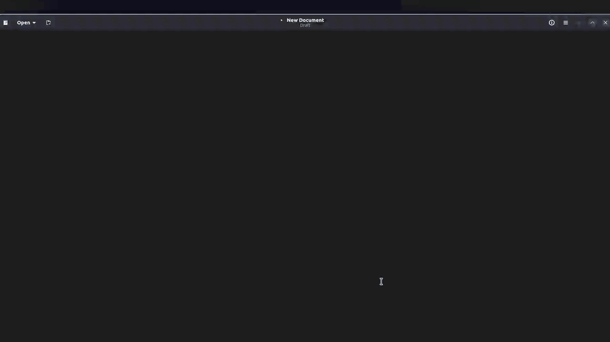
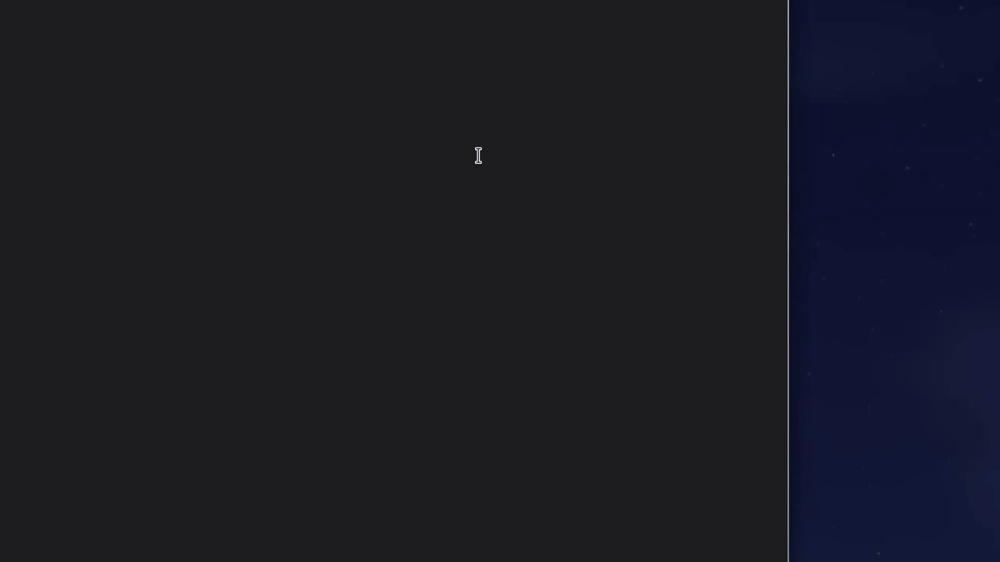

<div align="center">


# Sonori

**Local AI dictation for Linux: speak, and the text lands where you type**

Real-time or on-demand transcription, entirely on your device.

[](LICENSE)
[](#system-requirements)
[](#compositor-wayland)

<br>



**[▶ Watch the full demo (39 s)](assets/sonori-demo.mp4)**: dictation with live words, the quick menu, and Settings

</div>

---

> **Note:** Active development. You may encounter bugs or instability as new features are added.

## Features

### Core
- **Local AI Processing** - All transcription happens on your device, no cloud services required
- **Multi-Backend Support** - Choose between CTranslate2, Whisper.cpp, Moonshine, Parakeet TDT, or Nemotron 3.5 ASR (streaming) backends
- **Shared STT Runtime** - Speech capture, VAD, model downloads, and backend inference are provided by the reusable [`speechcore`](https://crates.io/crates/speechcore) crate ([source](https://github.com/0xPD33/speechcore)), maintained as a separate dependency and pulled in automatically when building
- **Dual Transcription Modes** - Real-time continuous transcription or manual on-demand sessions
- **Voice Activity Detection** - Uses Silero VAD for accurate speech detection
- **Automatic Model Download** - Models are downloaded automatically on first run

### Interface
- **Cursor Mode** (default) - A small glass tile follows your pointer while you dictate, and a bubble shows the text. A bubble for a failed paste stays until you close it, and you can drag it aside
- **Quick Menu** - Hold the hotkey (or run `sonori menu`) for language, Magic Mode, output, model, display, and your last five dictations
- **Model Picker** - Five models, one for each need: Parakeet v2 (most accurate English), Parakeet v3 (25 languages), Nemotron 3.5, Whisper turbo (99 languages), and Moonshine base (smallest)
- **Settings Window** - `sonori settings` or the tray opens every option; `sonori settings speech` opens one section
- **Transparent Overlay** - A fixed panel at the bottom of the screen with a spectrogram and typewriter text; used in real-time mode and on X11, or set `display_mode = "Overlay"`
- **CLI Mode** - Run without GUI using `--cli` flag for headless/terminal usage
- **System Tray Integration** - Quick access with window control and status display
- **`sonori doctor`** - Checks what your desktop supports and prints a report

<table>
  <tr>
    <td align="center" valign="top"><br><sub>The quick menu opens at the pointer</sub></td>
    <td align="center" valign="top"><br><sub>Settings: every option, saved at once</sub></td>
  </tr>
</table>

### Optional Features
- **GPU Acceleration** - Vulkan-based rendering; Whisper.cpp Vulkan acceleration; ONNX Runtime GPU acceleration for Moonshine, Parakeet TDT, and Nemotron 3.5 ASR backends
- **Global Shortcuts** - System-wide hotkeys via XDG Desktop Portal (e.g., Super+\ to toggle recording)
- **Auto-Paste** - Pastes into the focused app with the right shortcut (Ctrl+Shift+V in terminals, Ctrl+V elsewhere), notices when no app took the paste, and restores your clipboard afterwards
- **Type Mode** - Inserts the text through the input method protocol on niri and Sway: no clipboard and no key events
- **Sound Feedback** - Audio cues for recording state changes
- **Magic Mode** - Post-process transcriptions through a local LLM to clean up grammar, remove filler words, and improve readability
- **Words While You Speak** (off by default) - The bubble shows your words while you dictate. It needs a GPU and a fast model such as Parakeet; see [CONFIGURATION.md](CONFIGURATION.md#live-words-ui_configlive_text)
- **Training Data** (off by default) - Saves the audio and text of each dictation in the NeMo manifest format, so you can test or fine-tune a model on your own voice; see [CONFIGURATION.md](CONFIGURATION.md#training-data-training_data)

Sonori keeps no dictation on disk unless you turn on the history or the training data. Settings shows a warning before either turns on.

### Roadmap

**Planned:**
- Better error handling and UI improvements
- CUDA support for GPU acceleration
- Additional local AI backends
- Optional cloud API support (Deepgram, OpenAI)

**Not Planned:**
- GUI framework (custom wgpu/wgsl implementation by design)
- Windows/macOS support (contributions welcome)

## System Requirements

**Platform:** Linux x86_64 only

**Tested on:** NixOS with niri and KDE Plasma/KWin. VM tests run Sway, Hyprland, KDE Plasma, and GNOME (`nix build .#checks.x86_64-linux.vm-sway -L`)

### Compositor (Wayland)

| Protocol | Required | Purpose |
|----------|----------|---------|
| `zwlr_layer_shell_v1` | **Yes** | Cursor mode and the overlay |
| `zwlr_data_control_v1` | No | Paste check and clipboard restore |
| `zwp_input_method_manager_v2` | No | Type mode without key events (fallback: wtype/dotool) |
| XDG Portal: GlobalShortcuts | No | System-wide hotkeys |
| XDG Portal: RemoteDesktop | No | Auto-paste via portal (fallback: wtype/dotool) |

**Compositor Compatibility:**
| Compositor | Status |
|------------|--------|
| niri | ✅ Full support (bind `sonori toggle` to a key) |
| KDE Plasma (KWin) | ✅ Full support |
| Sway | ✅ Full support (bind `sonori toggle` to a key) |
| Hyprland | ✅ Works in the VM test |
| GNOME (Mutter) | ❌ No layer shell (use CLI mode) |

### Hardware
- **GPU:** Vulkan-capable with appropriate drivers
- **Audio:** Working microphone, PipeWire or PulseAudio

## Installation

Prebuilt files are on the [Releases page](https://github.com/0xPD33/sonori/releases/latest). Before each release, CI starts both of them on Ubuntu 24.04, Debian stable, Fedora, and Arch.

They bring ONNX Runtime, PortAudio, OpenSSL 3, and JACK with them. Your system must supply:
- a Vulkan driver for your GPU and the Vulkan loader (`libvulkan1`, `vulkan-loader`, or `vulkan-icd-loader`)
- ALSA (`libasound2t64`, `alsa-lib`), which every desktop install has
- `wl-clipboard`, and `wtype` or `dotool`, for copy and auto-paste

### AppImage (Recommended)

```bash
chmod +x Sonori-*-x86_64.AppImage
./Sonori-*-x86_64.AppImage
```

An AppImage mounts itself with FUSE 2 (`libfuse2t64` on Debian/Ubuntu, `fuse-libs` on Fedora, `fuse2` on Arch). Without it, start the AppImage with `--appimage-extract-and-run`.

### Release Tarball

```bash
tar -xzf sonori-*-x86_64-linux.tar.gz
./sonori-*-x86_64-linux/sonori
```

The tarball also holds the desktop file and the icons in `share/`.

### NixOS

```bash
# Try without installing
nix run github:0xPD33/sonori

# Install to profile
nix profile add github:0xPD33/sonori
```

Or add to your flake:
```nix
{
  inputs.sonori.url = "github:0xPD33/sonori";
  # Then add: inputs.sonori.packages.${system}.default
}
```

### Building from Source

Sonori depends on [**speechcore**](https://github.com/0xPD33/speechcore) (the shared speech-to-text runtime). Cargo fetches it as a git dependency, so you need no manual checkout. The system dependencies below cover both crates.

**Prerequisites:** [rustup](https://rustup.rs/). It installs the Rust version that `rust-toolchain.toml` pins.

**Debian/Ubuntu, Fedora, Arch, and their derivatives (Omarchy, Manjaro, Pop!_OS, ...):**

```bash
git clone https://github.com/0xPD33/sonori
cd sonori
scripts/install-deps.sh             # distro packages + ONNX Runtime 1.22.0 in /usr/local (uses sudo)
export $(scripts/install-deps.sh --env)
cargo build --release
./target/release/sonori
```

CI builds with this script on Ubuntu 24.04, Debian stable, Fedora, and Arch, and repeats the build every week. On other distros, install the equivalents of the packages that the script lists.

<details>
<summary><strong>NixOS</strong></summary>

```bash
nix develop  # All dependencies included
cargo build --release
```
</details>

### Desktop Integration

**NixOS:** Automatic via Nix flake.

**Other distributions:** run this from a source checkout. It installs the desktop file, the AppStream metadata, and the icons. The desktop file starts `sonori`, so put the binary on your `PATH`.
```bash
./install-desktop.sh --user        # User installation (recommended)
sudo ./install-desktop.sh --system # System-wide installation
```

See [desktop/README.md](desktop/README.md) for details.

## Usage

### GUI Mode (Default)

```bash
sonori
```

1. In cursor mode, a short notice says that Sonori is ready and which hotkey is bound
2. **Manual mode** (default): Press the global hotkey (default `Super+\`) or run `sonori toggle` to start and stop a session. A glass tile follows your pointer while you talk; the text is pasted into the focused app. Long dictations are transcribed at pauses while you speak, so the text arrives soon after you stop
3. **Quick menu:** Hold the hotkey, or run `sonori menu`
4. **Real-time mode:** Recording starts automatically, and the transparent overlay shows the text
5. With the overlay, use its buttons to copy text, clear history, switch modes, or exit
6. On X11, `Tab` also toggles a manual session while the overlay has keyboard focus. On Wayland the overlay never takes focus, so the paste lands in your app.

### CLI Mode

```bash
sonori --cli
```

- Transcription appears directly in terminal
- Real-time mode: auto-starts recording
- Manual mode: use spacebar to start/stop
- `Ctrl+C` to exit

### Command Line Options

| Option | Description |
|--------|-------------|
| `--cli` | Run in CLI mode without GUI |
| `--mode <realtime\|manual>` | Set transcription mode (default: manual) |
| `--manual` | Shorthand for `--mode manual` |
| `--help` | Show help information |
| `--version` | Display version |

### IPC Commands (External Control)

Control a running Sonori instance via CLI subcommands. Useful for compositor keybindings on niri, sway, etc. where XDG GlobalShortcuts portal isn't available.

```bash
sonori toggle      # Toggle recording on/off
sonori start       # Start recording session
sonori stop        # Stop recording session
sonori cancel      # Cancel session without processing
sonori status      # Get current status (JSON): mode, backend, hotkey
sonori switch-mode manual|realtime
sonori copy-last   # Copy the last transcript to the clipboard
sonori paste-last  # Paste the last transcript again
sonori magic       # Turn Magic Mode on or off
sonori language de # Set the transcription language (applies from the next recording)
sonori menu        # Open or close the quick menu
sonori settings    # Open the Settings window (add a section: general, speech, microphone, look, words, advanced)
sonori doctor      # Check what this desktop supports
```

Starting `sonori` while another instance runs replaces that instance.

**Example niri keybinding** (`~/.config/niri/config.kdl`):
```kdl
binds {
    Mod+backslash { spawn "sonori" "toggle"; }
}
```

## Configuration

Sonori uses `config.toml` for configuration. Defaults work well for most users. New configs default to the Whisper.cpp backend; existing user configs keep their selected backend.

**Quick Setup:** Choose a preset from the [Configuration Guide](./CONFIGURATION.md):
- **Fast & Lightweight** - Good for older computers
- **Balanced Performance** - Recommended for most users
- **High Quality** - For powerful computers with GPU
- **Real-Time** - Live transcription as you speak
- **Multilingual** - For non-English languages
- **Moonshine** - ONNX-based backend with fast real-time performance
- **Parakeet TDT** - NVIDIA NeMo model via sherpa-onnx, multilingual or English-only
- **Nemotron 3.5 ASR** - NVIDIA streaming model (cache-aware FastConformer + RNNT); NVIDIA names 15 languages as ready for transcription

## Troubleshooting

Run `sonori doctor` first. It checks the compositor, portals, paste helpers, GPU, and microphones, and prints what works. It changes nothing. Paste its output into a bug report.

### Wayland / Layer Shell

Sonori uses `zwlr_layer_shell_v1` for the transparent overlay.

- Verify Wayland session: `echo $XDG_SESSION_TYPE` should return `wayland`
- Check [Compositor Compatibility](#compositor-wayland) table above
- GNOME/Mutter doesn't support layer shell - use CLI mode (`--cli`)

### Vulkan / GPU

Required for UI rendering and optional GPU-accelerated transcription.

- Install the Vulkan loader and the driver for your GPU: `mesa-vulkan-drivers` on Debian/Ubuntu and Fedora; `vulkan-radeon`, `vulkan-intel`, or `nvidia-utils` on Arch
- Test with: `vulkaninfo` or `vkcube`
- For GPU transcription: enable `gpu_enabled = true` in `[backend_config]`

### XDG Desktop Portal Features

**Global Shortcuts** (`enable_global_shortcuts` in `[portal_config]`):
- Requires KDE Plasma 6+ or GNOME 45+
- Accept permission dialog on first run
- Check portal is running: `systemctl --user status xdg-desktop-portal`

**Auto-Paste** (`enable_xdg_portal` in `[portal_config]`):
- Uses XDG RemoteDesktop portal for keyboard injection (KDE Plasma)
- Falls back to `wtype` when portal is unavailable (sway, Hyprland, niri, river, labwc, COSMIC)
- Falls back to `dotool` if wtype also fails (works on all compositors via uinput — requires `input` group membership)
- Puts the text in the clipboard, then sends the paste shortcut. `paste_shortcut = "auto"` (the default) asks niri, Sway, or Hyprland which app has focus: terminals get Ctrl+Shift+V, other apps Ctrl+V. `ctrl_shift_v` or `ctrl_v` forces one shortcut
- With `zwlr_data_control_v1` (every compositor but GNOME), Sonori sees whether an app read the paste. If none did, the bubble says "Not pasted — it is in the clipboard". After a good paste, Sonori restores your old clipboard
- A portal paste that fails falls back to wtype/dotool; if every method fails, the bubble says "Copied, paste failed" and the text stays on the clipboard
- `output_mode` (Settings → Behavior → Output) picks `Paste`, `Type` (inserts the text through the input method protocol on niri and Sway, else wtype/dotool types it; the clipboard stays untouched) or `Clipboard` (copy only)

### Model Issues

**Automatic conversion fails:**
```bash
# NixOS
nix-shell model-conversion/shell.nix
ct2-transformers-converter --model your-model --output_dir ~/.cache/speechcore/models/your-model-ct2 --copy_files preprocessor_config.json tokenizer.json

# Other distros
pip install -U ctranslate2 huggingface_hub torch transformers
ct2-transformers-converter --model your-model --output_dir ~/.cache/speechcore/models/your-model-ct2 --copy_files preprocessor_config.json tokenizer.json
```

**Long dictations:** Sonori cuts a long manual recording at the first pause after `chunk_duration_seconds` (in `[manual_mode_config]`) and transcribes each part while you speak. Whisper's 448-token limit can still truncate very dense speech in one part; a lower `chunk_duration_seconds` (15-25) helps.

**Moonshine model layout:** Moonshine uses ONNX merged models (auto-downloaded) and expects a model name like `tiny` or `base`. If you see decoder input errors, set `[moonshine_options].enable_cache = false` and retry.

**Parakeet model layout:** Parakeet uses INT8 split ONNX models via sherpa-onnx (auto-downloaded from HuggingFace). STT models are stored under `~/.cache/speechcore/models/` by default.

**Nemotron model layout:** Nemotron 3.5 ASR uses split ONNX models (encoder/decoder/joint, int4) auto-downloaded from HuggingFace. It uses the language from `general_config.language`, for example `de` or `de-DE`, or `auto`.

## Known Issues

- GNOME has no layer shell; Sonori runs there only in CLI mode
- Chromium and Electron apps take Type mode text only with `--enable-wayland-ime`; otherwise Sonori types keys
- Transcription accuracy depends on backend and model quality
- CPU usage can be high when idle (buffer size related)

## Contributing

Contributions welcome! Whether fixing bugs, adding features, improving docs, or testing on different distributions.

**Getting Started:**
- See [ARCHITECTURE.md](./ARCHITECTURE.md) to understand the codebase
- Check planned features and known issues above
- Test on your distribution
- Open an issue or PR

## Credits

- [Rust](https://www.rust-lang.org/)
- [CTranslate2](https://github.com/OpenNMT/CTranslate2) / [Faster Whisper](https://github.com/SYSTRAN/faster-whisper)
- [whisper.cpp](https://github.com/ggerganov/whisper.cpp) / [whisper-rs](https://codeberg.org/tazz4843/whisper-rs)
- [ONNX Runtime](https://github.com/microsoft/onnxruntime)
- [OpenAI Whisper](https://github.com/openai/whisper)
- [Moonshine](https://github.com/moonshine-ai/moonshine)
- [NVIDIA NeMo / Parakeet TDT](https://github.com/NVIDIA/NeMo)
- [sherpa-onnx](https://github.com/k2-fsa/sherpa-onnx)
- [Silero VAD](https://github.com/snakers4/silero-vad)
- [CPAL](https://github.com/RustAudio/cpal)
- [Winit Fork](https://github.com/SergioRibera/winit)
- [WGPU](https://github.com/gfx-rs/wgpu)

## License

MIT License - see [LICENSE](LICENSE) for details.
